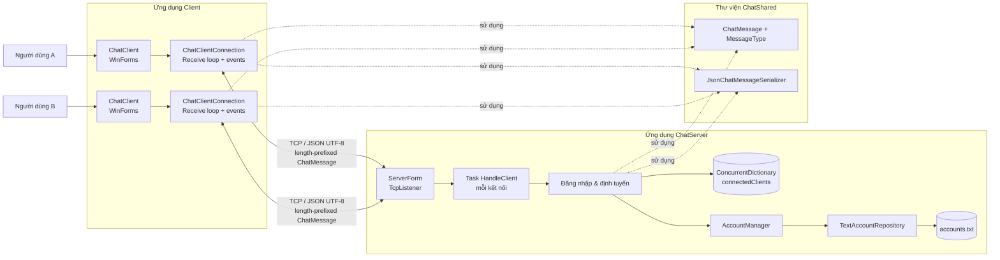
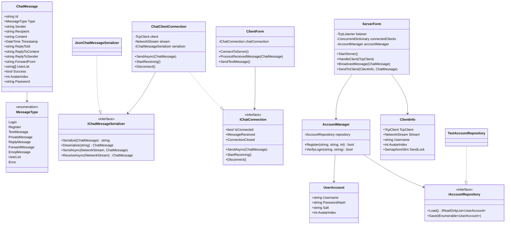
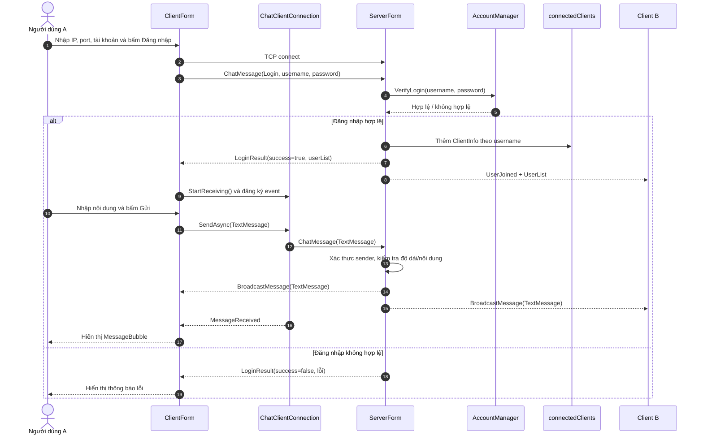

# Thiết kế kiến trúc hệ thống

> Tài liệu này mô tả thiết kế của phiên bản nền tảng: kết nối TCP, đăng ký/đăng nhập, quản lý người dùng trực tuyến và định tuyến tin nhắn. Các tính năng Reply, Forward và Emoji dùng chung phong bì `ChatMessage` và sẽ được hoàn thiện ở các tuần sau.

## 1. Sơ đồ kiến trúc tổng thể

**Nguyên tắc:** Client không giao tiếp trực tiếp với nhau. Mọi tin nhắn luôn đi qua Server để xác thực người gửi, chọn người nhận hoặc broadcast, sau đó Server mới gửi lại cho các Client phù hợp.

## 2. Class Diagram

## 3. Sequence Diagram — Đăng nhập và gửi tin nhắn công khai
Sơ đồ mô tả luồng đăng nhập của người dùng A và việc gửi một tin nhắn công khai (broadcast) qua Server. Có hai nhánh: đăng nhập hợp lệ và không hợp lệ.

Giải thích ngắn
Bước	Mô tả
1–5	Client kết nối TCP, gửi `Login`; Server nhờ `AccountManager` xác thực tài khoản.
6–17 (nhánh hợp lệ)	Server lưu `ClientInfo`, báo cho Client B, Client A bắt đầu nhận tin; A gửi tin, Server kiểm tra rồi broadcast cho A và B, giao diện hiển thị `MessageBubble`.
18–19 (nhánh không hợp lệ)	Server trả `LoginResult(success=false)`, Client hiển thị lỗi.
